

<picture>
  <source media="(prefers-reduced-motion: reduce)" srcset="assets/profile/about/greeting.svg">
  
</picture>

<picture>
    <source media="(prefers-reduced-motion: reduce) and (max-width: 600px)" srcset="assets/profile/stats/code-counter-mobile.png">
    <source media="(prefers-reduced-motion: reduce)" srcset="assets/profile/stats/code-counter.png">
    <source media="(max-width: 600px)" srcset="assets/profile/stats/code-counter-mobile.gif">
    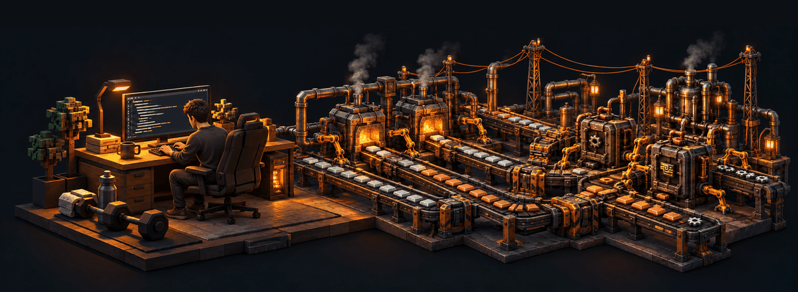
  </picture>

<picture>
  <source media="(prefers-reduced-motion: reduce) and (max-width: 600px)" srcset="assets/profile/about/university-mobile.png">
  <source media="(prefers-reduced-motion: reduce)" srcset="assets/profile/about/university.png">
  <source media="(max-width: 600px)" srcset="assets/profile/motion/about/university-mobile.svg">
  
</picture>

<h2>
<picture>
  <source media="(prefers-reduced-motion: reduce) and (max-width: 600px)" srcset="assets/profile/headings/about-mobile.svg">
  <source media="(prefers-reduced-motion: reduce)" srcset="assets/profile/headings/about.svg">
  <source media="(max-width: 600px)" srcset="assets/profile/motion/headings/about-mobile.svg">
  
</picture>
</h2>

<picture>
  <source media="(prefers-reduced-motion: reduce) and (max-width: 600px)" srcset="assets/profile/about/bio-mobile.svg">
  <source media="(prefers-reduced-motion: reduce)" srcset="assets/profile/about/bio.svg">
  <source media="(max-width: 600px)" srcset="assets/profile/motion/about/bio-mobile.svg">
  
</picture>

<h2>
<picture>
  <source media="(prefers-reduced-motion: reduce) and (max-width: 600px)" srcset="assets/profile/headings/technologies-mobile.svg">
  <source media="(prefers-reduced-motion: reduce)" srcset="assets/profile/headings/technologies.svg">
  <source media="(max-width: 600px)" srcset="assets/profile/motion/headings/technologies-mobile.svg">
  
</picture>
</h2>

<h3><picture>
  <source media="(prefers-reduced-motion: reduce)" srcset="assets/profile/headings/languages.svg">
  
</picture></h3>

<picture>
  <source media="(prefers-reduced-motion: reduce)" srcset="assets/profile/stack/java.svg">
  
</picture> <picture>
  <source media="(prefers-reduced-motion: reduce)" srcset="assets/profile/stack/lua.svg">
  
</picture>

<h3><picture>
  <source media="(prefers-reduced-motion: reduce)" srcset="assets/profile/headings/build.svg">
  
</picture></h3>

<picture>
  <source media="(prefers-reduced-motion: reduce)" srcset="assets/profile/stack/maven.svg">
  
</picture> <picture>
  <source media="(prefers-reduced-motion: reduce)" srcset="assets/profile/stack/gradle.svg">
  
</picture>

<h3><picture>
  <source media="(prefers-reduced-motion: reduce)" srcset="assets/profile/headings/tools.svg">
  
</picture></h3>

<picture>
  <source media="(prefers-reduced-motion: reduce)" srcset="assets/profile/stack/git.svg">
  
</picture> <picture>
  <source media="(prefers-reduced-motion: reduce)" srcset="assets/profile/stack/github.svg">
  
</picture> <picture>
  <source media="(prefers-reduced-motion: reduce)" srcset="assets/profile/stack/intellij-idea.svg">
  
</picture> <picture>
  <source media="(prefers-reduced-motion: reduce)" srcset="assets/profile/stack/linux.svg">
  
</picture> <picture>
  <source media="(prefers-reduced-motion: reduce)" srcset="assets/profile/stack/docker.svg">
  
</picture> <picture>
  <source media="(prefers-reduced-motion: reduce)" srcset="assets/profile/stack/docker-compose.svg">
  
</picture> <picture>
  <source media="(prefers-reduced-motion: reduce)" srcset="assets/profile/stack/github-actions.svg">
  
</picture>

<h3><picture>
  <source media="(prefers-reduced-motion: reduce)" srcset="assets/profile/headings/backend.svg">
  
</picture></h3>

<picture>
  <source media="(prefers-reduced-motion: reduce)" srcset="assets/profile/stack/jdbc.svg">
  
</picture>

<picture>
  <source media="(prefers-reduced-motion: reduce)" srcset="assets/profile/stack/spring-boot.svg">
  
</picture> <picture>
  <source media="(prefers-reduced-motion: reduce)" srcset="assets/profile/stack/spring-mvc.svg">
  
</picture> <picture>
  <source media="(prefers-reduced-motion: reduce)" srcset="assets/profile/stack/spring-jdbc.svg">
  
</picture> <picture>
  <source media="(prefers-reduced-motion: reduce)" srcset="assets/profile/stack/jdbctemplate.svg">
  
</picture> <picture>
  <source media="(prefers-reduced-motion: reduce)" srcset="assets/profile/stack/spring-data-jpa.svg">
  
</picture> <picture>
  <source media="(prefers-reduced-motion: reduce)" srcset="assets/profile/stack/spring-security.svg">
  
</picture>

<picture>
  <source media="(prefers-reduced-motion: reduce)" srcset="assets/profile/stack/sql.svg">
  
</picture> <picture>
  <source media="(prefers-reduced-motion: reduce)" srcset="assets/profile/stack/postgresql.svg">
  
</picture> <picture>
  <source media="(prefers-reduced-motion: reduce)" srcset="assets/profile/stack/hibernate.svg">
  
</picture> <picture>
  <source media="(prefers-reduced-motion: reduce)" srcset="assets/profile/stack/flyway.svg">
  
</picture>

<picture>
  <source media="(prefers-reduced-motion: reduce)" srcset="assets/profile/stack/rest-api.svg">
  
</picture> <picture>
  <source media="(prefers-reduced-motion: reduce)" srcset="assets/profile/stack/http.svg">
  
</picture> <picture>
  <source media="(prefers-reduced-motion: reduce)" srcset="assets/profile/stack/websocket.svg">
  
</picture> <picture>
  <source media="(prefers-reduced-motion: reduce)" srcset="assets/profile/stack/json.svg">
  
</picture> <picture>
  <source media="(prefers-reduced-motion: reduce)" srcset="assets/profile/stack/bean-validation.svg">
  
</picture>

<picture>
  <source media="(prefers-reduced-motion: reduce)" srcset="assets/profile/stack/apache-kafka.svg">
  
</picture> <picture>
  <source media="(prefers-reduced-motion: reduce)" srcset="assets/profile/stack/spring-kafka.svg">
  
</picture>

<picture>
  <source media="(prefers-reduced-motion: reduce)" srcset="assets/profile/stack/spring-boot-actuator.svg">
  
</picture> <picture>
  <source media="(prefers-reduced-motion: reduce)" srcset="assets/profile/stack/slf4j.svg">
  
</picture> <picture>
  <source media="(prefers-reduced-motion: reduce)" srcset="assets/profile/stack/logback.svg">
  
</picture>

<h3><picture>
  <source media="(prefers-reduced-motion: reduce)" srcset="assets/profile/headings/qa.svg">
  
</picture></h3>

<picture>
  <source media="(prefers-reduced-motion: reduce)" srcset="assets/profile/stack/junit.svg">
  
</picture> <picture>
  <source media="(prefers-reduced-motion: reduce)" srcset="assets/profile/stack/mockito.svg">
  
</picture> <picture>
  <source media="(prefers-reduced-motion: reduce)" srcset="assets/profile/stack/mockmvc.svg">
  
</picture> <picture>
  <source media="(prefers-reduced-motion: reduce)" srcset="assets/profile/stack/testcontainers.svg">
  
</picture>

<picture>
  <source media="(prefers-reduced-motion: reduce)" srcset="assets/profile/stack/selenide.svg">
  
</picture> <picture>
  <source media="(prefers-reduced-motion: reduce)" srcset="assets/profile/stack/webdrivermanager.svg">
  
</picture> <picture>
  <source media="(prefers-reduced-motion: reduce)" srcset="assets/profile/stack/page-object.svg">
  
</picture> <picture>
  <source media="(prefers-reduced-motion: reduce)" srcset="assets/profile/stack/xpath.svg">
  
</picture>

<picture>
  <source media="(prefers-reduced-motion: reduce)" srcset="assets/profile/stack/rest-assured.svg">
  
</picture> <picture>
  <source media="(prefers-reduced-motion: reduce)" srcset="assets/profile/stack/jsonpath.svg">
  
</picture>

<picture>
  <source media="(prefers-reduced-motion: reduce)" srcset="assets/profile/stack/jenkins.svg">
  
</picture> <picture>
  <source media="(prefers-reduced-motion: reduce)" srcset="assets/profile/stack/selenoid.svg">
  
</picture> <picture>
  <source media="(prefers-reduced-motion: reduce)" srcset="assets/profile/stack/allure.svg">
  
</picture>

<h2>
<picture>
  <source media="(prefers-reduced-motion: reduce) and (max-width: 600px)" srcset="assets/profile/headings/learning-mobile.svg">
  <source media="(prefers-reduced-motion: reduce)" srcset="assets/profile/headings/learning.svg">
  <source media="(max-width: 600px)" srcset="assets/profile/motion/headings/learning-mobile.svg">
  
</picture>
</h2>

<picture>
  <source media="(prefers-reduced-motion: reduce)" srcset="assets/profile/study/jvm.svg">
  
</picture> <picture>
  <source media="(prefers-reduced-motion: reduce)" srcset="assets/profile/study/threads.svg">
  
</picture> <picture>
  <source media="(prefers-reduced-motion: reduce)" srcset="assets/profile/study/executor.svg">
  
</picture>

<picture>
  <source media="(prefers-reduced-motion: reduce)" srcset="assets/profile/study/advanced-sql.svg">
  
</picture> <picture>
  <source media="(prefers-reduced-motion: reduce)" srcset="assets/profile/study/explain.svg">
  
</picture> <picture>
  <source media="(prefers-reduced-motion: reduce)" srcset="assets/profile/study/mvcc.svg">
  
</picture> <picture>
  <source media="(prefers-reduced-motion: reduce)" srcset="assets/profile/study/locks.svg">
  
</picture>

<picture>
  <source media="(prefers-reduced-motion: reduce)" srcset="assets/profile/study/liquibase.svg">
  
</picture>

<picture>
  <source media="(prefers-reduced-motion: reduce)" srcset="assets/profile/study/oauth2.svg">
  
</picture> <picture>
  <source media="(prefers-reduced-motion: reduce)" srcset="assets/profile/study/oidc.svg">
  
</picture> <picture>
  <source media="(prefers-reduced-motion: reduce)" srcset="assets/profile/study/pkce-jwt.svg">
  
</picture> <picture>
  <source media="(prefers-reduced-motion: reduce)" srcset="assets/profile/study/spring-oauth2.svg">
  
</picture>

<picture>
  <source media="(prefers-reduced-motion: reduce)" srcset="assets/profile/study/registry.svg">
  
</picture> <picture>
  <source media="(prefers-reduced-motion: reduce)" srcset="assets/profile/study/env-secrets.svg">
  
</picture> <picture>
  <source media="(prefers-reduced-motion: reduce)" srcset="assets/profile/study/linux-deploy.svg">
  
</picture> <picture>
  <source media="(prefers-reduced-motion: reduce)" srcset="assets/profile/study/health-rollback.svg">
  
</picture>

<picture>
  <source media="(prefers-reduced-motion: reduce)" srcset="assets/profile/study/openapi.svg">
  
</picture> <picture>
  <source media="(prefers-reduced-motion: reduce)" srcset="assets/profile/study/swagger.svg">
  
</picture> <picture>
  <source media="(prefers-reduced-motion: reduce)" srcset="assets/profile/study/postman.svg">
  
</picture>

<h2>
<picture>
  <source media="(prefers-reduced-motion: reduce) and (max-width: 600px)" srcset="assets/profile/headings/projects-mobile.svg">
  <source media="(prefers-reduced-motion: reduce)" srcset="assets/profile/headings/projects.svg">
  <source media="(max-width: 600px)" srcset="assets/profile/motion/headings/projects-mobile.svg">
  
</picture>
</h2>

<a href="https://github.com/Kriksson/item-bro">
  <picture>
  <source media="(prefers-reduced-motion: reduce) and (max-width: 600px)" srcset="assets/profile/projects/item-bro-mobile.svg">
  <source media="(prefers-reduced-motion: reduce)" srcset="assets/profile/projects/item-bro.svg">
  <source media="(max-width: 600px)" srcset="assets/profile/motion/projects/item-bro-mobile.svg">
  
</picture>
</a>

<a href="https://github.com/Kriksson/QA_Item_Bro">
  <picture>
  <source media="(prefers-reduced-motion: reduce) and (max-width: 600px)" srcset="assets/profile/projects/QA_Item_Bro-mobile.svg">
  <source media="(prefers-reduced-motion: reduce)" srcset="assets/profile/projects/QA_Item_Bro.svg">
  <source media="(max-width: 600px)" srcset="assets/profile/motion/projects/QA_Item_Bro-mobile.svg">
  
</picture>
</a>

<a href="https://github.com/Kriksson/javaLearnAI">
  <picture>
  <source media="(prefers-reduced-motion: reduce) and (max-width: 600px)" srcset="assets/profile/projects/javaLearnAI-mobile.svg">
  <source media="(prefers-reduced-motion: reduce)" srcset="assets/profile/projects/javaLearnAI.svg">
  <source media="(max-width: 600px)" srcset="assets/profile/motion/projects/javaLearnAI-mobile.svg">
  
</picture>
</a>

<a href="https://github.com/Kriksson/mcskill-helper-forge">
  <picture>
  <source media="(prefers-reduced-motion: reduce) and (max-width: 600px)" srcset="assets/profile/projects/mcskill-helper-forge-mobile.svg">
  <source media="(prefers-reduced-motion: reduce)" srcset="assets/profile/projects/mcskill-helper-forge.svg">
  <source media="(max-width: 600px)" srcset="assets/profile/motion/projects/mcskill-helper-forge-mobile.svg">
  
</picture>
</a>

<a href="https://github.com/Kriksson/QA_Learn">
  <picture>
  <source media="(prefers-reduced-motion: reduce) and (max-width: 600px)" srcset="assets/profile/projects/QA_Learn-mobile.svg">
  <source media="(prefers-reduced-motion: reduce)" srcset="assets/profile/projects/QA_Learn.svg">
  <source media="(max-width: 600px)" srcset="assets/profile/motion/projects/QA_Learn-mobile.svg">
  
</picture>
</a>

<a href="https://github.com/Kriksson/coc-donation-bot">
  <picture>
  <source media="(prefers-reduced-motion: reduce) and (max-width: 600px)" srcset="assets/profile/projects/coc-donation-bot-mobile.svg">
  <source media="(prefers-reduced-motion: reduce)" srcset="assets/profile/projects/coc-donation-bot.svg">
  <source media="(max-width: 600px)" srcset="assets/profile/motion/projects/coc-donation-bot-mobile.svg">
  
</picture>
</a>

<a href="https://github.com/Kriksson/dtv-bot">
  <picture>
  <source media="(prefers-reduced-motion: reduce) and (max-width: 600px)" srcset="assets/profile/projects/dtv-bot-mobile.svg">
  <source media="(prefers-reduced-motion: reduce)" srcset="assets/profile/projects/dtv-bot.svg">
  <source media="(max-width: 600px)" srcset="assets/profile/motion/projects/dtv-bot-mobile.svg">
  
</picture>
</a>

<a href="https://github.com/Kriksson/UniCode">
  <picture>
  <source media="(prefers-reduced-motion: reduce) and (max-width: 600px)" srcset="assets/profile/projects/UniCode-mobile.svg">
  <source media="(prefers-reduced-motion: reduce)" srcset="assets/profile/projects/UniCode.svg">
  <source media="(max-width: 600px)" srcset="assets/profile/motion/projects/UniCode-mobile.svg">
  
</picture>
</a>

<h2>
<picture>
  <source media="(prefers-reduced-motion: reduce) and (max-width: 600px)" srcset="assets/profile/headings/contacts-mobile.svg">
  <source media="(prefers-reduced-motion: reduce)" srcset="assets/profile/headings/contacts.svg">
  <source media="(max-width: 600px)" srcset="assets/profile/motion/headings/contacts-mobile.svg">
  
</picture>
</h2>

<a href="https://t.me/kriksson" title="Telegram: @kriksson"><picture>
  <source media="(prefers-reduced-motion: reduce)" srcset="assets/profile/contacts/telegram.svg">
  
</picture></a>&nbsp; <a href="mailto:k.kriksson@gmail.com" title="Email: k.kriksson@gmail.com"><picture>
  <source media="(prefers-reduced-motion: reduce)" srcset="assets/profile/contacts/email.svg">
  
</picture></a>

