

<picture>
  
</picture>

<picture>
    <source media="(max-width: 600px)" srcset="assets/profile/stats/code-counter-mobile.svg">
    
  </picture>

<picture>
    <source media="(max-width: 600px)" srcset="assets/profile/about/university-mobile.png">
    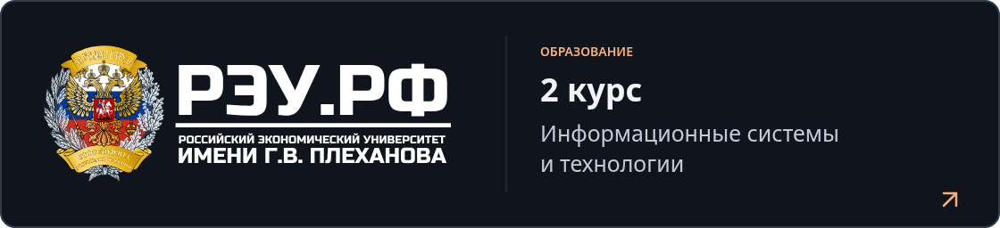
  </picture>

<h2>
<picture>
  <source media="(max-width: 600px)" srcset="assets/profile/headings/about-mobile.svg">
  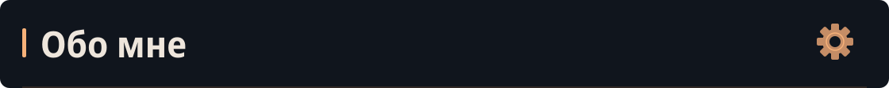
</picture>
</h2>

<picture>
  <source media="(max-width: 600px)" srcset="assets/profile/about/bio-mobile.svg">
  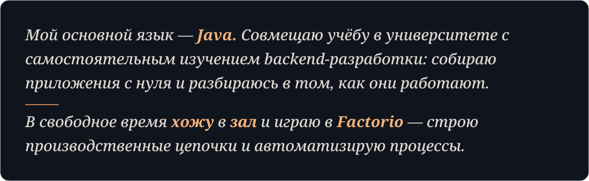
</picture>

<h2>
<picture>
  <source media="(max-width: 600px)" srcset="assets/profile/headings/technologies-mobile.svg">
  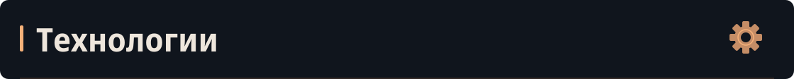
</picture>
</h2>

<h3><picture>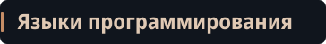</picture></h3>

<picture>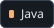</picture> <picture>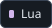</picture>

<h3><picture></picture></h3>

<picture>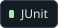</picture> <picture>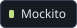</picture> <picture></picture> <picture></picture> <picture>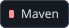</picture> <picture>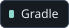</picture>

<h3><picture></picture></h3>

<picture>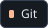</picture> <picture></picture> <picture>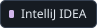</picture> <picture>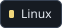</picture> <picture>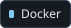</picture> <picture>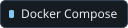</picture> <picture></picture>

<h3><picture></picture></h3>

<picture>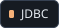</picture>

<picture></picture> <picture>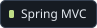</picture> <picture></picture> <picture>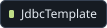</picture> <picture></picture> <picture>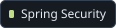</picture>

<picture></picture> <picture></picture> <picture>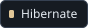</picture> <picture></picture>

<picture>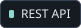</picture> <picture></picture> <picture></picture> <picture></picture> <picture>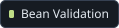</picture>

<picture>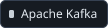</picture> <picture>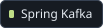</picture>

<picture>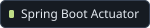</picture> <picture>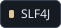</picture> <picture>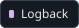</picture>

<h2>
<picture>
  <source media="(max-width: 600px)" srcset="assets/profile/headings/learning-mobile.svg">
  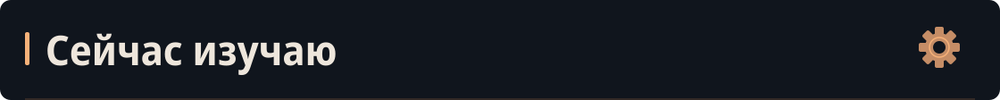
</picture>
</h2>

<picture></picture> <picture></picture> <picture>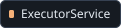</picture>

<picture>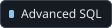</picture> <picture>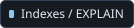</picture> <picture></picture> <picture>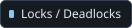</picture>

<picture>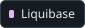</picture>

<picture>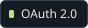</picture> <picture>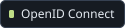</picture> <picture></picture> <picture>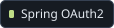</picture>

<picture>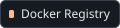</picture> <picture>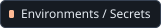</picture> <picture>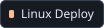</picture> <picture>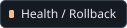</picture>

<picture>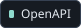</picture> <picture>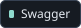</picture> <picture>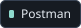</picture>

<h2>
<picture>
  <source media="(max-width: 600px)" srcset="assets/profile/headings/projects-mobile.svg">
  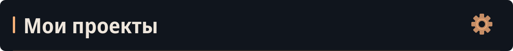
</picture>
</h2>

<a href="https://github.com/Kriksson/item-bro">
  <picture>
    <source media="(max-width: 600px)" srcset="assets/profile/projects/item-bro-mobile.svg">
    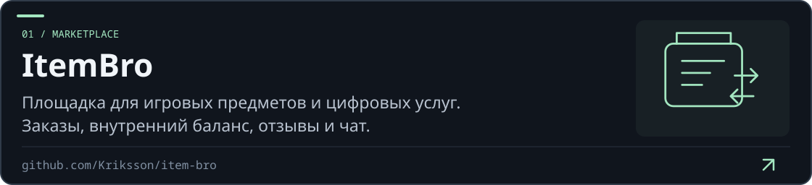
  </picture>
</a>

<a href="https://github.com/Kriksson/javaLearnAI">
  <picture>
    <source media="(max-width: 600px)" srcset="assets/profile/projects/javaLearnAI-mobile.svg">
    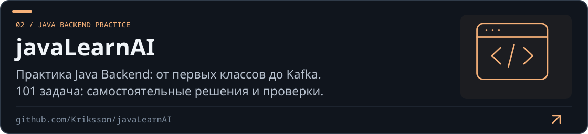
  </picture>
</a>

<a href="https://github.com/Kriksson/mcskill-helper-forge">
  <picture>
    <source media="(max-width: 600px)" srcset="assets/profile/projects/mcskill-helper-forge-mobile.svg">
    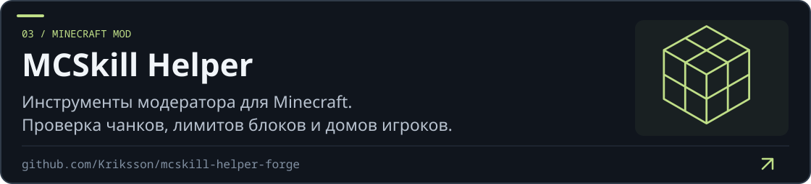
  </picture>
</a>

<a href="https://github.com/Kriksson/dtv-bot">
  <picture>
    <source media="(max-width: 600px)" srcset="assets/profile/projects/dtv-bot-mobile.svg">
    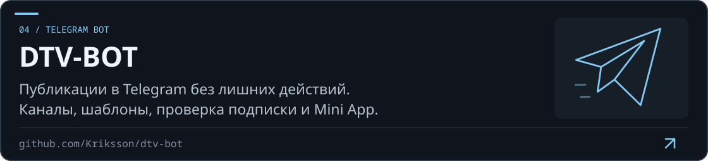
  </picture>
</a>

<a href="https://github.com/Kriksson/UniCode">
  <picture>
    <source media="(max-width: 600px)" srcset="assets/profile/projects/UniCode-mobile.svg">
    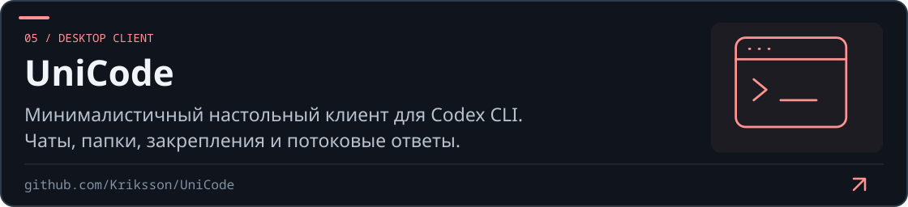
  </picture>
</a>

<h2>
<picture>
  <source media="(max-width: 600px)" srcset="assets/profile/headings/contacts-mobile.svg">
  
</picture>
</h2>

&nbsp; 

